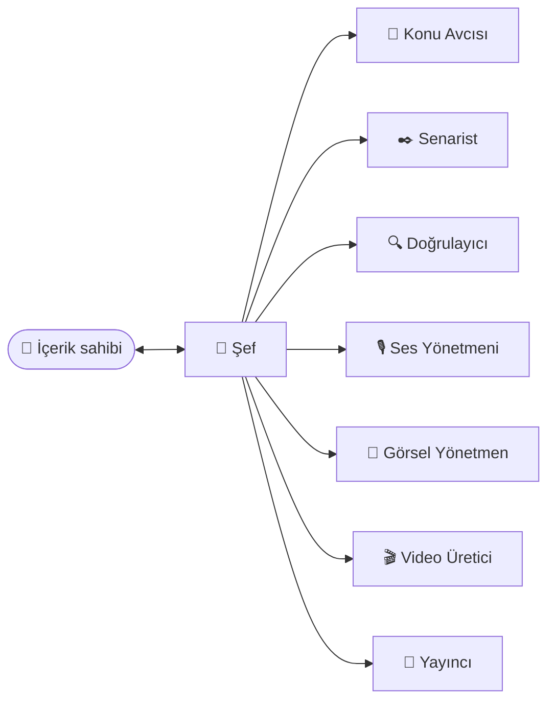
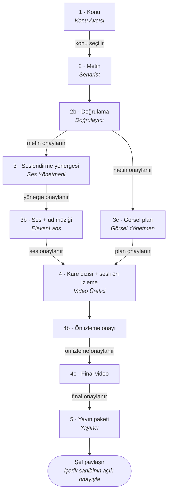

<div align="center">

# Hemdem

**Eski sözlerle bugünün yüklerine dokunan Türkçe Instagram reels'i, bir yapay zekâ ekibiyle üreten sistem**

*Hemdem* (Osmanlıca): sırdaş, can yoldaşı; kelime anlamıyla "aynı nefesi paylaşan".

> *"Bunu yaşayan tek kişi sen değilsin."*

</div>

---

## Bu nedir?

Hemdem, psikoloji ve felsefe temalı, 40–45 saniyelik Türkçe reels'leri **baştan sona** üreten bir sistemdir: konuyu bulur, metni yazar, sözleri doğrular, sahneleri kurgular, seslendirir, müziği besteler ve videoyu **kodla çizer**.

Sistem, [Claude Code](https://claude.com/claude-code) üzerinde çalışan **bir Şef ve yedi uzman agent**'tan oluşur. Her agent tek bir işi yapar; bir sonraki adıma ancak içerik sahibi onay verince geçilir. İçerik sahibi yalnızca Şef'le konuşur.

Her videonun merkezinde bir **Sav** durur: bir atasözü, bir deyim, bir şairin dizesi ya da unutulmaya yüz tutmuş bir kelime. Video bu sözü bugünün tanıdık bir anıyla buluşturur ve cevap vermeden, düşündüren bir soruyla ya da cümleyle biter.

| Üç temel unsur | |
|---|---|
| **Tanıdık acı** | Herkesin yaşadığı ama pek konuşulmayan bir baskı ya da duygu |
| **Tanıdık dil** | Atasözü, deyim, Yunus Emre, Mevlana, halk sözü |
| **Teselli** | İzleyici yalnız olmadığını hisseder |

---

## Ekip



| Agent | Ne yapar | Ürettiği |
|---|---|---|
| **Şef** | Hattı yönetir. İçerik üretmez; her çıktıyı içerik sahibinin kriterlerine göre değerlendirir, öneri sunar, onayı alır, günü kaydeder. Ders defterini her gün okur, hatadan çıkan dersleri sisteme işletir. | `gunluk/<tarih>/durum.md` |
| **Konu Avcısı** | Her gün 5 zamansız öneri getirir: üç söz (sosyal baskı, düşünür sözü, iç duygu) ve iki kelime (unutulmaya yüz tutmuş bir Türkçe kelime, Türkçede karşılığı olmayan bir dünya kelimesi). Türkiye'ye özgü bir özel güne 1–2 gün kala bir özel gün önerisi ekler. Haber ve trend takip etmez. | `01-konular.md` |
| **Senarist** | Seçilen konudan 70–80 kelimelik seslendirme metni yazar: ilk 3 saniyede yakalayan bir açılış, Sav, sözün bugünkü izdüşümü ve açık uçlu bir kapanış. Yargılamaz, düşündürür. | `02-metin-<kod>.md` |
| **Doğrulayıcı** | Sözün aslını ve kime ait olduğunu, telif durumunu, tarih ve olgu iddialarını, kırmızı çizgileri ve tonu denetler. Kelimeleri TDK'nın veri adresinden sorgular. Net karar verir: hazır / düzeltme gerekli / kullanma. | `02b-dogrulama-<kod>.md` |
| **Ses Yönetmeni** | Metni ElevenLabs ile seslendirir. Her cümleye kendi tonunu verir (sakin, kaygılı, fısıltı, ağır…), sesi cümle cümle üretir, her kelimenin zamanını çıkarır. Geri bildirimde yalnızca istenen cümleyi yeniden üretir. Her videoya özel solo ud müziği besteler. | `ses.wav`, `hizalama.json`, `muzik.mp3` |
| **Görsel Yönetmen** | Metni sahne sahne akan bir minyatür filme çevirir: mekânlar, 5–9 çekim, her çekimdeki aksiyon, kamera, çekimler arası geçişler, ışık ve altın. | `03-gorsel-plan-<kod>.md` |
| **Video Üretici** | Planı motorla **kodla çizer**. Önce her çekimden kareleri (storyboard), sonra sesli ön izlemeyi, onaydan sonra finali üretir. Her kareyi "bir yabancı burada ne görür?" diye kendisi denetler. | `film.js`, `onizleme.mp4`, `final.mp4` |
| **Yayıncı** | Instagram paylaşım paketini hazırlar: ilk satırında anahtar kelime olan açıklama, 3–5 etiket, alt metin, kapak yazısı, paylaşım saati. Yayıncı paylaşmaz; paylaşımı Şef, içerik sahibinin açık onayıyla yapar. | `05-yayin-<kod>.md` |

---

## Üretim hattı



- **Her okun üstünde bir kapı var:** içerik sahibi onaylamadan bir sonraki adım başlamaz.
- **Ses videodan önce gelir.** Video bütün zamanlarını gerçek sesten alır; altyazı, kamera ve hareketler kelimesi kelimesine sese oturur. Senkron kayması yapısal olarak imkânsız.
- **Revizyonda yalnızca sorunlu yer düzelir.** Bir cümlenin tonu beğenilmezse yalnızca o cümle, bir çekim beğenilmezse yalnızca o çekim yeniden üretilir.

---

## Görsel dil: Hemdem Minyatür

Videolar Osmanlı minyatür ve tezhip geleneğinden beslenen, **sahne sahne akan kısa filmlerdir.**

- **Düz pigment, kalın kontur.** Hacim gölgeyle değil, üstübeç çizgi ve noktalarla.
- **Altın bir malzemedir, renk değil.** Kare kare döşenmiş varak, bir ışık (kandil, güneş) değene kadar sönük durur; ışık değince parlar, etrafına halkalar yayılır.
- **Her çekimde aksiyon.** Figürler yürür, eğilir, uzanır, güler; fincan ters çevrilir, kandil kısılır. Kamera her çekimde hareket eder.
- **Tasarlanmış geçişler.** Kesintisiz kamera, eşleşen şekil (yuvarlak minder → yuvarlak sini), ön plan silmesi (önden geçen servi sırası), çerçeveden geçiş (kahvehane kapısından içeri), sert kesme.
- **Anılar altın gökyüzüyle** ayrılır; şimdiki zaman lacivert gecedir.
- **Tezhip bordür, üstte Sav kartuşu, altta sabit parşömen altyazı.**
- **Ses:** sabit Hemdem sesi (sıcak, orta yaşlı, İstanbul ağızlı bir anlatıcı) ve altında solo ud taksimi.

Stilin ilham kaynağı ve lisans notları: [`tasarim/REFERANSLAR.md`](tasarim/REFERANSLAR.md).

---

## Motor

Videolar bir video düzenleyiciyle değil, **kodla** üretilir: her film bir JavaScript dosyasıdır, motor onu Chrome'da kare kare çizip MP4'e çevirir.

| Dosya | Görevi |
|---|---|
| [`motor/minyatur.js`](motor/minyatur.js) | Minyatür çizim kütüphanesi: pigment paleti, altın varak, figürler (oturan, yürüyen, gülen), mekân öğeleri, kamera, çekimler ve geçişler, kartuş, altyazı, tezhip bordür |
| [`motor/render.js`](motor/render.js) | Film dosyasını Chrome'da çizer; tek kare (PNG) ya da video (MP4) |
| [`motor/ses-uret.js`](motor/ses-uret.js) | ElevenLabs ile cümle cümle tonlu seslendirme; kelime zamanları (`hizalama.json`) |
| [`motor/muzik-uret.js`](motor/muzik-uret.js) | ElevenLabs Music ile her videoya özel, sözsüz solo ud |
| [`motor/birlestir.js`](motor/birlestir.js) | Görüntü, ses ve müziği birleştirir; müziği ölçüp sesin altına oturtur, son karışım −14 LUFS |
| [`motor/ornekler/minyatur-sahneli.js`](motor/ornekler/minyatur-sahneli.js) | Örnek film: 5 çekim, 4 geçiş |

Bir filmin iskeleti:

```js
window.FILM = {
  style: 'minyatur',
  subs: 'ses',            // altyazılar sesin kelime zamanlarından otomatik
  render(g, t, M) {
    M.cekimler(g, t, [
      { a: 0,          b: M.c(5).bas, ciz: oda, gecis: { tur: 'esles' } },
      { a: M.c(5).bas, b: M.c(6).bas, ciz: ani, gecis: { tur: 'silme', on: 'servi' } },
      { a: M.c(6).bas, b: 99,         ciz: kahvehane },
    ]);
  },
};
```

`M.c(5).bas` = 5. cümlenin söylendiği saniye, `M.k(2, 'ters')` = 2. cümlede "ters" kelimesinin söylendiği an. Hiçbir zaman elle yazılmaz. Ayrıntılı kılavuz: [`motor/README.md`](motor/README.md).

---

## Hafıza ve öğrenme

| Dosya | İçeriği |
|---|---|
| [`MARKA.md`](MARKA.md) | Marka rehberi: kimlik, ton, reels iskeleti, kırmızı çizgiler, görsel kimlik. Bütün agent'ların ortak pusulası |
| [`sef-kriterleri.md`](sef-kriterleri.md) | Şef'in her adımı değerlendirdiği kriterler (🔴 kırmızı çizgiler) |
| [`arsiv/dersler.md`](arsiv/dersler.md) | **Ders defteri:** her kalıcı karar ve hatadan çıkan ders. Bir ders ancak ilgili talimat dosyasına işlenince "işlendi" sayılır |
| [`arsiv/islenen-konular.md`](arsiv/islenen-konular.md) | İşlenen konular; tekrarı önler |
| [`arsiv/savlar.md`](arsiv/savlar.md) | Yayınlanan her videonun Sav'ı ve kapanışı; ileride kitap ve ürün için |

---

## Klasör yapısı

```
Hemdem/
├── CLAUDE.md               proje talimatı (ana oturum her zaman Şef'tir)
├── MARKA.md                marka rehberi
├── sef-kriterleri.md       değerlendirme kriterleri
├── .claude/
│   ├── agents/             yedi uzman agent
│   └── skills/sef/         Şef
├── motor/                  kodla video, ses ve müzik üretimi
├── arsiv/                  ders defteri, konular, savlar
├── atolye/                 agent'ları çalışırken gösteren yerel sayfa
├── tasarim/                stil denemeleri ve referanslar
└── gunluk/<tarih>/         her günün üretimi (depoda yok)
```

---

## Kurulum

Gerekenler: [Claude Code](https://claude.com/claude-code), Node.js 20+, Google Chrome (ya da Edge), ffmpeg, bir ElevenLabs hesabı (seslendirme ve müzik için).

```bash
git clone https://github.com/cobanhuseyinbahadir/Hemdem.git
cd Hemdem/motor
npm install
```

ElevenLabs anahtarı koda ya da dosyaya yazılmaz; Windows'ta kullanıcı ortam değişkeni olarak tutulur:

```powershell
[Environment]::SetEnvironmentVariable('ELEVENLABS_API_KEY', 'sk_...', 'User')
```

Sonra proje klasöründe Claude Code'u açıp Şef'e seslenmek yeterli:

```
/sef günü başlat
```

---

## Depoda olmayanlar

Günlük üretim klasörü (`gunluk/`), ses, video ve görsel dosyaları ile API anahtarı bilerek depoya konmaz (bkz. [`.gitignore`](.gitignore)). Medya dosyaları bilgisayarda kalır ve film dosyalarından yeniden üretilebilir.

<div align="center">

*Hemdem sorar, söylemez.*

</div>
